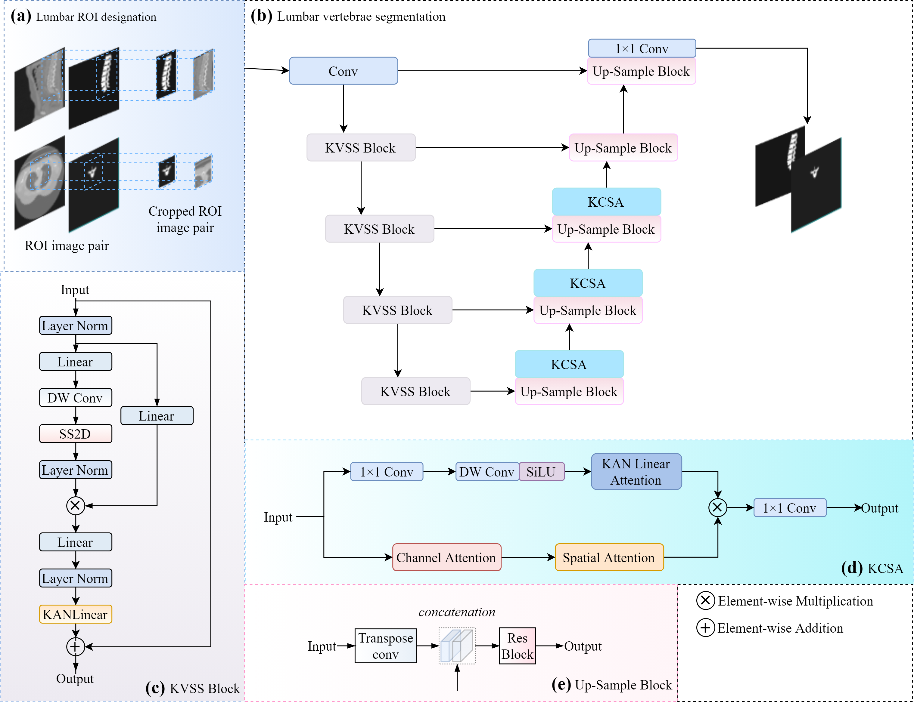

# TA-Mamba

**A novel Triple Attentions based Mamba for Lumbar CT Segmentation**

## Introduction

Accurate segmentation of lumbar vertebrae from computed tomography (CT) images is essential for clinical diagnosis and preoperative planning of lumbar diseases. However, existing methods still face challenges arising from severe class imbalance, ambiguous vertebral boundaries, and the scarcity of large-scale, multi-pathological annotated lumbar CT datasets.

**TA-Mamba** is a hybrid Mamba–U-Net segmentation network built on top of the [nnU-Net v2](https://github.com/MIC-DKFZ/nnUNet) framework. Its key components are:

- **2D Visual State-Space Model (VSSM) encoder** — a VMamba-style encoder with four-directional 2D selective scans (SS2D) that models long-range context with linear complexity.
- **Kolmogorov–Arnold Network (KAN) layers** — KANLinear layers embedded inside each VSS block replace fixed-activation MLPs with learnable spline-based transformations for more expressive and interpretable feature mapping.
- **KAN-based triple attention module (MKCSA)** — a multi-branch KAN-based channel–spatial attention module on the decoder skip connections, which fuses multi-head KAN linear attention with channel–spatial attention to capture subtle edge features and resolve blurred boundaries.
- **Deep supervision** — multi-resolution output heads for stabilized optimization.

## Architecture



The network follows an encoder–decoder design with feature maps at five scales `[48, 96, 192, 384, 768]`. The VSSM encoder performs four-directional 2D selective scans with KAN linear layers, while the decoder uses KAN-based triple attention modules on the skip connections.

## Dataset

We release a lumbar CT dataset (**DLC**) comprising **120 patients** across four pathological categories: normal lumbar vertebrae, osteophytosis, spondylolisthesis, and scoliosis.

The dataset (**DLC.zip**) can be downloaded from Baidu Netdisk:

- Link: https://pan.baidu.com/s/1kJA6kSShI_xdARbjCId--g?pwd=27fu
- Extraction code: `27fu`

## Code Release

> **The paper is currently under review.** The complete source code, together with the preprocessing, training, inference and evaluation pipelines, will be publicly released upon publication.

## Citation

The paper is currently under review. Citation information will be added upon publication.

Please also cite the nnU-Net framework:

```bibtex
@article{isensee2021nnunet,
  title   = {nnU-Net: a self-configuring method for deep learning-based biomedical image segmentation},
  author  = {Isensee, Fabian and Jaeger, Paul F. and Kohl, Simon A. and Petersen, Jens and Maier-Hein, Klaus H.},
  journal = {Nature methods},
  volume  = {18},
  number  = {2},
  pages   = {203--211},
  year    = {2021}
}
```

## Acknowledgements

This work is built upon the following open-source projects. We thank their authors:

- [nnU-Net](https://github.com/MIC-DKFZ/nnUNet)
- [VMamba](https://github.com/MzeroMiko/VMamba)
- [Mamba](https://github.com/state-spaces/mamba)
- [KAN](https://github.com/KindXiaoming/pykan)
- [MONAI](https://github.com/Project-MONAI/MONAI)

## License

This project is released under the [Apache License 2.0](LICENSE), consistent with nnU-Net.
